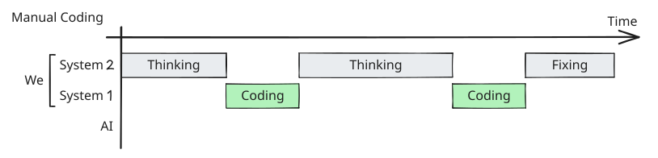
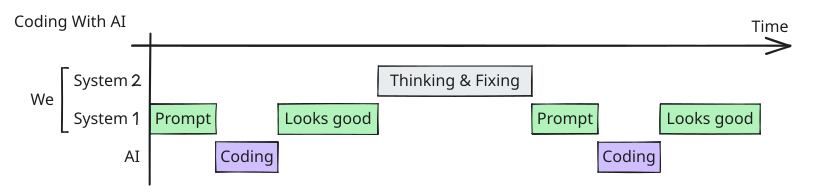

Traditional code is deterministic. Programming languages had an exactly defined syntax and semantics, and a machine enforced them. In 1978 Dijkstra called formal notation “an amazingly effective tool for ruling out all sorts of nonsense”, in a note arguing against programming in natural language. I have been thinking about that note a lot, because natural language is now how I program with AI.

<h2>Seventy years of giving up control</h2>

The history of programming is a history of handing control to the machine, one layer at a time. In assembly you explain to the computer <em>how</em> to do something, step by step. In SQL you mostly say <em>what</em> you want, and the database works out how to get it. Each layer moved us a little further from how and a little closer to what. But whatever we wrote down, at any layer, still meant exactly one thing, because a formal definition sat underneath.

<table class="kt-table">
<thead><tr><th>Layer</th><th>What you stopped deciding</th><th>What stayed exact</th></tr></thead>
<tbody>
<tr><td>Assembly, 1950s</td><td>Hand-encoding opcodes</td><td>One mnemonic maps to one opcode</td></tr>
<tr><td>FORTRAN, 1957</td><td>Registers and instruction selection</td><td>Language rules the compiler enforces</td></tr>
<tr><td>SQL, 1970s</td><td>How rows get fetched</td><td>A schema that fixes every column and type</td></tr>
<tr><td>ORMs and GC, 2000s</td><td>Writing the SQL, freeing the memory</td><td>Types and the API contract</td></tr>
<tr class="kt-new"><td>LLMs, 2023+</td><td>The how, and now the exact what</td><td>The generated code, but not your request</td></tr>
</tbody></table>

Now I just tell the AI what I want, and it works out the how. It feels like the natural next step. But for the first time, what I write down doesn’t have one exact meaning. A SQL query can only be read one way. A sentence in English can be read many ways, and the model picks one.

That doesn’t mean the formal layer is gone. An agent writes ordinary code, and that code still has to parse and type-check. What changed is who the compiler talks to. A type error used to land on my screen and stop me. Now it lands in the agent’s loop and is usually fixed before I see it. The compiler can tell the model that a program is valid. It has no way of telling anyone that this is the program I meant.

Between what I mean and the code, there used to be a step only I could do, and it was checked. Now that step is a sentence in English.

Take this one: “If the beer is cold, drink it. Otherwise, put it in the fridge.” If I write that by hand, I have to define everything it mentions. A condition like <code>cold</code> needs an actual temperature, and <code>fridge</code> has to exist somewhere. If I leave any of that out, the program doesn’t compile.

As a prompt, the same sentence goes through without any of those definitions. How cold is “cold”? Which fridge? The whole beer or a sip? What if there is no beer? I don’t have to answer these questions anymore, because the AI answers them for me. Ask an agent three times and you can get three different programs:

<b>Literal and minimal</b><pre class="kt-code"><code>if (beer.temp &lt; 8)
  drink(beer);
else
  fridge.add(beer);</code></pre>

<b>Over-engineered</b><pre class="kt-code"><code>if (!beer)
  return suggest("soda");
if (beer.celsius &lt;= 5)
  return drink(beer);
kitchen.fridge.store(beer);
reminder.set("check 2h");</code></pre>

<b>Another reading entirely</b><pre class="kt-code"><code>// "cold" = guessed 7°C
const COLD = 7;
if (getTemp(beer) &lt; COLD)
  pour(beer, glasses = 2);
else
  nearestFridge().put(beer);</code></pre>

None of these is wrong. Cold means 8°C in the first program, 5°C in the second and 7°C in the third. I never defined it. The AI did, in a different way each time, and the compiler accepts all three.

That changes the order of the work. By hand, I had to think before the code would compile. With AI, the code comes first, and the thinking happens afterwards, while I fix it.

<h2>Two systems</h2>

Kahneman’s <em>Thinking, Fast and Slow</em> describes two modes of thinking. He is careful to say that the two systems are useful fictions and that the terms come from the psychologists Keith Stanovich and Richard West. They are still the best description I know of what happens when I work with an agent.

<b>System 1</b><i>Fast, automatic, effortless</i>
Reads a face and knows: angry.

Types the code your hands already know.

<b>System 2</b><i>Slow, deliberate, effortful</i>
Works out 17 × 24 step by step.

Decides what to build, and how.

Programming has always moved between the two. You decide in System 2, type in System 1, and go back to System 2 for the next decision. The first timeline below shows that rhythm. The second shows what happens to it with AI.

<!-- TODO Sabine: Die Grafiken basieren auf einer fremden Idee. Quelle raussuchen und in der figcaption nennen. -->
<figure class="kt-figure">

<figcaption>A sketch of how the time is spent, not a measurement.</figcaption></figure>

The part that matters here is a detail of how the switch happens. Kahneman calls System 2 lazy. It follows the law of least effort and mostly accepts what System 1 suggests. It only takes over when something goes wrong, when System 1 runs into a surprise it cannot handle.

A compiler error is exactly such a surprise. So is a failing test, or a function you have to name and can’t, because you don’t yet know what it does. We usually describe these as friction. I now think they were also doing a job: they kept pulling us back into System 2 whether we felt like it or not. Thinking was built into the work as a side effect.

<h2>“Make the button more visible”</h2>

Recently I told my coding agent exactly that.

<b>What I wrote</b>“Make the button more visible.”

<b>What I meant</b>It gets lost between three grey links in the footer. Put it somewhere else, in a different colour.

<b>What I got</b>A bigger button, still in the footer.

The agent did nothing wrong. It did what I wrote. The mistake was mine: I hadn’t finished the thought, and I hoped the tool would finish it for me. I was treating the model as if it did my System 2 work.

Nothing in that exchange pushed back. There was no error and no surprise. There is always an answer, and it is almost right. So the loop becomes: prompt, “close enough,” patch prompt, another patch, and at some point you no longer understand your own project.

<h2>“But reasoning models deliberate”</h2>

They do, and I’m not claiming LLMs can’t reason. A current model will get Kahneman’s bat-and-ball puzzle right. But a model deliberates over what is in its context. The information that matters here, what <em>you</em> want, which constraints exist, what “done” means, is often not in the context. It is in your head, and sometimes it isn’t there yet either, because you haven’t decided. No amount of model-side System 2 can recover a decision nobody has made.

<h2>The question quietly changes</h2>

Two more ideas from the book explain why this is so hard to notice.

The first is cognitive ease. When something is easy to process, we tend to feel that it is true and familiar, and we relax. Generated code is very easy to process. It is well named, well formatted, and comes with a confident explanation. Everything about it signals that no further effort is needed.

The second is substitution. When System 1 meets a hard question, it often answers an easier one and doesn’t tell you. Kahneman’s example: asked how happy you are with your life, you report your current mood. In code review, the hard question is “Is this the right thing, and is it correct in the cases I haven’t thought of?” The easy question is “Does it run, and does it look like good code?” With hand-written code the two were loosely tied together, because someone had to think through the details to produce it at all. With generated code the easy answer is always yes.

The clearest measurement of this gap I know is METR’s 2025 trial with 16 experienced open-source developers. They forecast that AI would make them 24% faster. They measured 19% slower. Afterwards the developers still believed they had been 20% faster. METR now says the speed result is out of date, and I wouldn’t use it to argue that AI makes you slow. What I find interesting is the distance between the feeling and the stopwatch.

<h2>Why System 1 can’t become the default</h2>

Suppose developers really do move to System 1 for good: describe, skim, accept. I see three problems.

Nobody decides. Every open question still gets an answer, but the answer is a guess made by a process that doesn’t know it was a question.

Nobody checks. Reviewing in System 1 means answering the easy question from above.

Nobody learns, and this is the one that worries me most. The fast intuition of a senior developer, the feeling that something in this function is off, is System 1. But it was built by System 2. Kahneman and Gary Klein describe the conditions for reliable expert intuition: a regular environment, and long practice with feedback. Compiler errors, failed tests and bugs you tracked down yourself were that practice. If the agent absorbs all of that feedback, I don’t see where the next generation’s intuition comes from, or how long my own lasts. And the less of it we have, the worse we get at the review that is supposed to keep everything safe.

<h2>What I do now</h2>

If the compiler no longer interrupts me, I have to interrupt myself. Before I send a non-trivial prompt, I stop and ask:

<ul class="kt-list">
<li>What exactly do I want, in my own words?</li>
<li>What do I know that the model can’t?</li>
<li>How will I recognise that it’s done?</li>
<li>Which gap would I not notice myself?</li>
<li>If this fails in three months, what will the reason have been?</li>
</ul>

The button prompt becomes:

“The button disappears in the footer between grey links. Move it below the form and give it the accent colour. Keep its size.”

For anything bigger, I write this down as a specification with acceptance criteria before the agent starts, and the criteria become tests. You can call the result a spec, a few bullet points, or one good sentence. The format matters much less than the order. The thinking happens before the prompt, when it is cheap, and I am the one who does it.

A spec has no compiler, so it isn’t the formal layer coming back. The parts that actually enforce something are the tests and the checks in the pipeline. The rest of the spec is an interruption I built for myself on purpose.

<h2>Isn’t this just waterfall?</h2>

It looks like it. Write the requirements first, then build. We spent twenty years learning why that goes wrong, and I don’t want to wave that away.

Part of waterfall’s problem was economic. Implementation was expensive and feedback arrived months later, so a wrong document cost a fortune. Even Royce’s 1970 paper, the usual origin of the model, calls the straight-through version “risky and invites failure.” If an agent can implement a spec in an hour, the cycle shrinks from months to an afternoon, and being wrong gets much cheaper. I would rather call that many small waterfalls, and you can argue with that name.

The other part of the problem hasn’t gone anywhere. Often you don’t know what you want until you see it. No spec fixes that. Brooks wrote “plan to throw one away” in 1975, and this is where vibe coding has a real place: when you build something to learn what you want, System 1 is fine. The prompt-and-see loop is a great way to explore. I think the line to draw runs between code you write to learn and code you intend to keep. The trouble starts when the first kind quietly becomes the second.

There is also a harder objection, and it applies to my own method. Waterfall documents failed partly because they looked complete. Kahneman has a name for that too: WYSIATI, what you see is all there is. System 1 builds a coherent story from what is in front of it and doesn’t notice what is missing. A hundred-page requirements document feels like understanding. A generated spec feels like it even more. Spec tools can turn one sentence into pages of tidy requirements with acceptance criteria, and that spec has all the properties of generated code: fluent, plausible, easy to approve. If I skim it and accept it, I have moved System 1 one level up and added paperwork.

A spec only helps if I did the thinking it records, and reading the document afterwards can’t tell me whether I did.

<h2>What I don’t know yet</h2>

For seventy years we moved from <em>how</em> to <em>what</em>, and we could afford it because whatever we wrote down stayed exact. Now we state the <em>what</em> in loose language. The computer used to reject what we hadn’t thought through. It now accepts it and answers.

I am fairly sure that System 2 is the one part of this job that can’t be delegated, because the decisions it makes don’t exist until someone makes them. I am much less sure how we keep it in the loop. The compiler did that without anyone having to care. Discipline is a weak replacement, and much of Kahneman’s book is about how little we can rely on it.

So I’m curious what others are doing. What interrupts you now that the compiler doesn’t? And if you started programming after agents arrived, where does your practice with feedback come from?

This post grew out of a talk on spec-driven coding I gave at Women in Tech in Freiburg.

